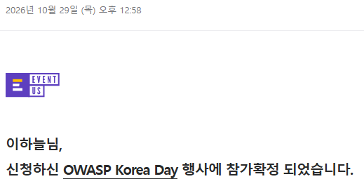
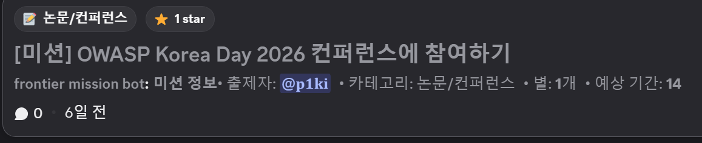
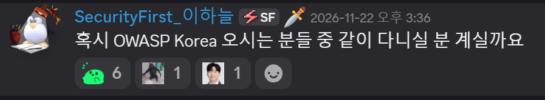
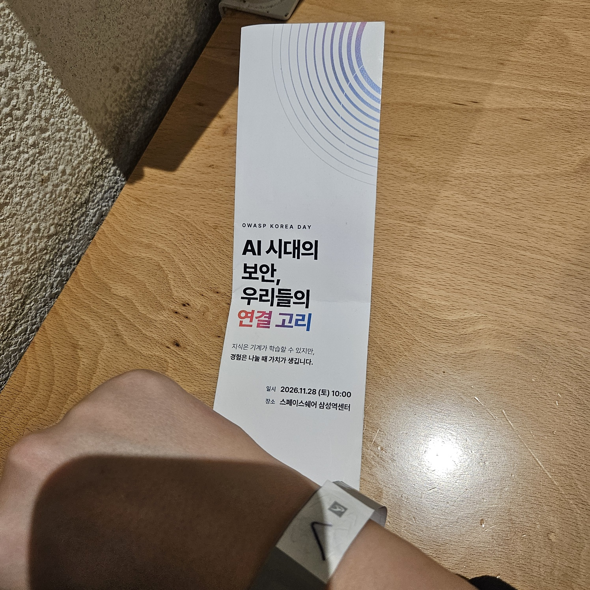
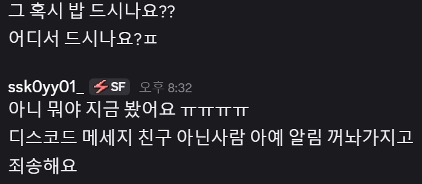
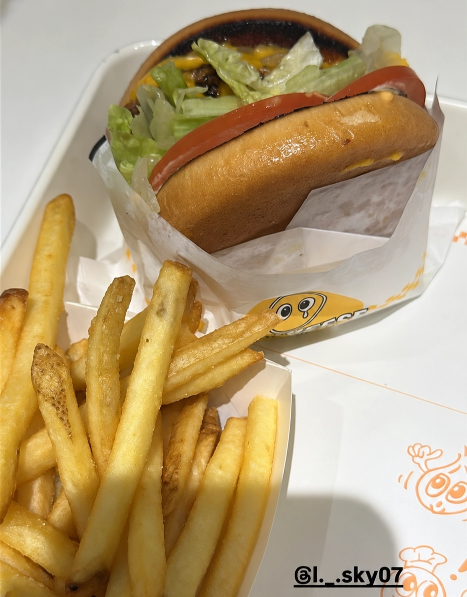
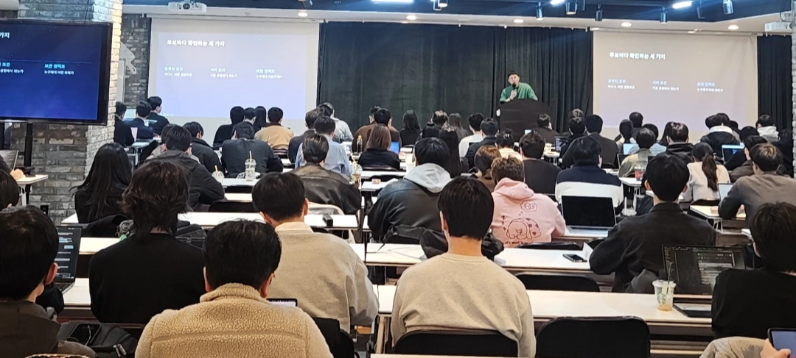
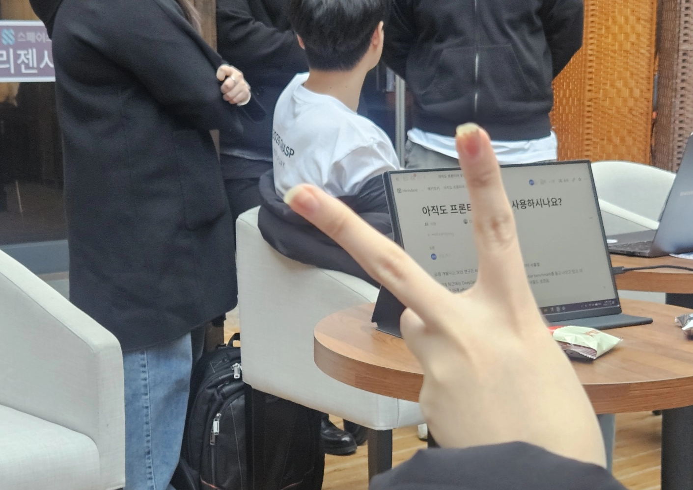

목차

시작하기 앞서서<br />컨퍼런스 도착!<br />나이프 사람들과의 만남<br />컨퍼런스 인상 깊었던 내용<br />후기

## 시작하기 앞서서

먼저! 시작하기 앞서서 해야할 말이 있다.<br />원래 나는 이 컨퍼런스를 미션 때문이 아닌 주변에서 같이 가지고 해서 신청을 하게 되었다.



그래서 이렇게 행복하게 신청을 하고 OWASP는 워낙 유명하니 어떤 주제들로 재밌게 발표 해주실까? 라고 생각하면서 기대하고 있었다.



그렇게 기다리다가 이게 뭔가??? 갑자기 딱 하고 미션이 오는게 너무 야무졌다.<br />그래서 눈 한 번 비벼서 이게 진짜인가? 확인 해보고 싱글벙글한 마음으로 미션을 잡았다.

여기까지는 좋았다.<br />하지만 같이 가자고 했던 주변인이 못가게 되어서 사실상 컨퍼런스를 혼자 가게 된 것이다.<br /><s>(컨퍼런스는 혼자 가면 좀 외롭다. 조금 많이.)</s>

그래서 좀 대책을 강구하다가 대단한 일을 벌이게 된다.



그렇다. 그냥 외로웠던 청년은 노빠꾸로 달아버렸다.

그렇게 하나 둘 씩 답장이 달리면서 재밌게 기대했던 기억이 있다.

솔직히 나이프 사람들을 입단식, 합강훈, A&D, 수료식 이렇게 4번의 오프라인 행사에서만 거의 볼 수 없으니까 조금 아쉬운 마음이 들었었다 (그래서 CTF 관련 오프라인 미션들이 생겨서 좋았다.)

이렇게 설레는 마음을? 가지며 컨퍼런스 날이 밝았다.

## 컨퍼런스 도착!

목적지는 삼성역 1호선이 지하철 파업 이슈로 조금 일찍 맞춰서 나와야겠다고 생각하고 8시 쯤 나왔다.<br />(시작 시간은 10시고 집에서 원래 1시간 10분 걸림)

하지만 하나도 안 막히고 부천역 → 신도림 → 삼성역 야무지게 안 막히고 도착해서 9시 20분이 되었다.<br />시작 시간까지는 너무 많이 남아서 일단 피곤하니 근처 메가커피에서 커피수혈 한 번 때려주고 컨퍼런스 장으로 갔다.

## 나이프 사람들과의 만남

컨퍼런스에 가서 디코를 보니.. 우사기 키링을 가지고 있다는 사진을 보고 일단 우사기를 찾아 다녔다.<br />그리고 발견해서 어색하게 어..! 우사기다!!! 이러면서 인사를 했던 기억이 있다.

나보다 빨리온 분이 3분 있었는데 먼저 인사하고 통성명을 나누었다.



그리고 들어오면 이렇게 팜플렛과 들낙할 수 있는 팔찌를 준다.<br />스티커도 가져갈 수 있었긴 한데 약간 밤티끼 나서 안 가져갔다.

그렇게 처음에는 나를 포함해서 4명..5명…6명…이렇게 늘어나면서 인사하고 인사하고

> 혹시 인스타…맞팔 하실래요? 시전 → 사람 너무 많아서 내 핸드폰 어디에 굴러다니는지 모름 이슈 발생으로 정신도 없었다.

인사한 얼굴들 중에서는 오프라인 입단식에서 얼굴을 봤던 익숙한 분들도 존재 했고, 온라인 입단식으로 아예 정식적으로 처음 인사하는 사람들도 다수 존재했다.

총 컨퍼런스 돌아다니면서 인사한 나이프 사람들만 15명 정도는 되는 것 같다.<br />이름 기억 잘 못하긴 하는데 일단 인스타부터 따고 다녔다.

그리고 운영진인 예준님도 계셨는데, 뭐 이번에 많이 대화할 수 있는 기회가 있었어서 조금 친해진거 같기도 하고? 뭐 그런가 보다 싶다.

추가로 나이프 사람들과 같이 점심도 먹었다.<br />원래 다른 분들도 같이 먹기로 했는데 중간에 어디갔는지 안 보여서 먼저 갔나보다\~ 하고 갔었다.



```c++
죄송합니다죄송합니다죄송합니다죄송합니다죄송합니다죄송합니다죄송합니다죄송합니다
죄송합니다죄송합니다죄송합니다죄송합니다죄송합니다죄송합니다죄송합니다죄송합니다
죄송합니다죄송합니다죄송합니다죄송합니다죄송합니다죄송합니다죄송합니다죄송합니다
죄송합니다죄송합니다죄송합니다죄송합니다죄송합니다죄송합니다죄송합니다죄송합니다

면목이 없네요… 합강훈 때는 꼭 같이 먹어요 ㅠㅠㅠㅠㅠㅠㅠㅠㅠㅠㅠㅠㅠㅠㅠㅠ
```

그래서 우리끼리 뭐 먹지? 하면서 물가 걱정을 하던 중 싼 햄버거 집을 발견해서 여기다! 하고 들어왔는데 거의 나이프 정모급이었다.



이렇게 보이는건 나 하나 뿐인데 일단 7명이서 먹었다.<br />개인정보를 가리느라 일단 내 인스타 아이디 태그 당한 것만 남기고 지운 것.

버거는 저 정도 해서 10000원 정도 한다.<br />요즘 삼성역 물가에서는 보지 못할 내 구세주 같은 가게였다.

이렇게 밥을 다 먹은 뒤 계속 컨퍼런스를 듣다가 맨 마지막 세션까지 정상적으로 끝난 후 서로 다음에 봐요\~ 합강훈에서 봐요\~\~ 하면서 헤어졌다.

## 컨퍼런스 인상 깊었던 내용

뭐 컨퍼런스를 가는데 왜 컨퍼런스 내용이 사람들 만난 것보다 왜 뒤에 있냐 싶을 수도 있다.<br />사실만 말하면 컨퍼런스 때 안 듣고 사람들이랑 친해지려고 놀았기 때문이다.

물론 컨퍼런스도 중요하고 정말 대단하신 분들이 온 것은 맞지만 많이 보지도 듣지도 못했기 때문에 일부분만 기억나는 것을 이야기 하겠다.

결론만 이야기 하면 <b>Earning Zero-Days with LLM</b>가 메인 세션 중에서는 가장 기억에 남았던 것 같다.



비록 초반에는 못 듣고 중반부터 듣기 시작했지만 LLM으로 몇 달간 실제 타깃을 버그 헌팅한 내용들과 어떻게 자신은 버그 헌팅을 하였는지, 성공한 점은 무엇이었는지 그리고 실패했다고 생각한 점을 무엇이었는지를 상세하게 알려주었다.

그리고 그것 뿐만이 아닌 오탐을 최대한 줄이는 방법과 찾는 부분과 검증을 하는 부분을 분리해서 분석하는 행동과 같은 꿀팁들을 말해주었기 때문에 더 좋았던 것 같다.<br />(이거는 나이프 오픈소스, 클로즈 소스 과제로 시도해볼 가치가 존재한다)

추가로 야외에서 진행하는 Hackyboiz 분들이 진행하는 세션도 많이 봤었는데, 되게 LLM과 관련된 내용과 레드팀과 관련된 내용, 추가로 개인정보와 관련된 지식들까지 우리에게 설명해줘서 좋았다.

Hackyboiz라는 팀 어디선가 들어본적은 있는데 실제로 소속 인원들은 처음 보는 것 같아서 새로운 느낌이 들었었다.



추가로 이렇게 사진 찍는 중 V행동을 취하셔서 소소하게 재밌었던 기억도 있다.

## 후기

먼저 컨퍼런스를 그렇게 많이 간 적이 없던 것 같다.<br />아마 동아리에서 다른 동아리와 주최하는 곳, 코드게이트 다음에 이곳을 와본 거일텐데 나이프 분들과 많이 대화할 수 있어서 개인적으로는 너무 만족했다.

실제로 친해진 사람도 많이 존재하고 아마 합강훈 때도 친하게 지내면서 대화할 것 같다.<br />그리고 다른 사람들이 메인 세션이나 다른 곳에서 발표하는 것들을 보니 나도 외부에서 발표를 하면서 자신의 지식을 다른 사람들에게 공유를 해보고 싶다는 생각도 들었다.

그래서 오늘 OWASP korea에 못 오신 분들은 합강훈 때 인사해서 친해지면 되고 여기서 어느정도 인사하고 대화한 사람들은 나중에는 더 친해져서 수료식이 끝난 이후에도 많은 사람들과 대화를 이어나가고 보안 대회나 컨퍼런스에서 많이 만나고 싶다.

다른 컨퍼런스 참여 같은 것도 이렇게 미션으로 내줘서 강제 친해지기 하는 것도 만족하고 좋을 것 같다고 생각한다.

-끝-


